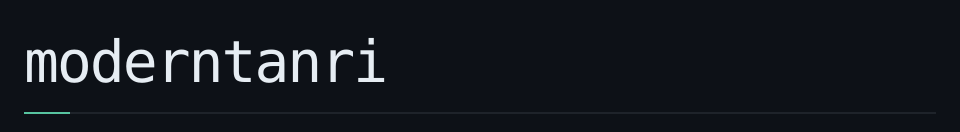
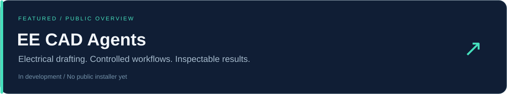

<b>Elektrik projeleriyle yazılımı bir araya getiriyorum.</b> CAD ve geometri · Otomasyon · Uygulamalı AI · Ses teknolojileri

<a href="#neler-yapıyorum">Çalışmalar</a> &nbsp;·&nbsp; <a href="#öne-çıkan-proje">Proje</a> &nbsp;·&nbsp; <a href="ENGINEERING.md">Teknik yaklaşım</a> &nbsp;·&nbsp; <a href="notes/README.md">Çalışma notları</a> &nbsp;·&nbsp; <a href="#english">English</a>

## Merhaba, ben Erencan.

Çizim masasında tekrar eden bir işi gördüğümde kurallarını çıkarıp onu bir araca dönüştürmeyi seviyorum. İlgi alanım geometriyle başlayıp veri işleme, masaüstü uygulamalar ve ajanların kullanabildiği araçlara uzanıyor.

Bir problemi çözerken önce neyin korunacağını belirlerim: çizimin mevcut bağlantıları, belgenin sayısal dayanağı veya müzik projesindeki yaratıcı niyet. Sonra işi parçalara ayırır; otomasyonun neyi değiştirdiğini inceleyebileceğim bir akış kurarım.

## Neler yapıyorum?

| Alan | Üzerinde çalıştığım işler |
| :--- | :--- |
| **CAD ve geometri** | AutoLISP araçları, toplu çizim işlemleri, ölçülendirme ve elektrik CAD iş akışları |
| **Veriden çizime** | Tabloları ve belgeleri yazılımın işleyebileceği yapılara dönüştürme; CAD çıktısı ve raporlama |
| **Otomasyon ve sistemler** | Python servisleri, C#/.NET masaüstü araçları, API entegrasyonları ve operasyon akışları |
| **AI ve yaratıcı araçlar** | Yerel AI, MCP/ajan arayüzleri, ses analizi ve insanın tarif ettiği işi uygulayan araçlar |

**AutoLISP · Python · C# / .NET · Rust · Git**

[Teknik yaklaşımımı ve çalışma alanlarımı incele →](ENGINEERING.md)

## Öne çıkan proje

[**EE-CAD-Agents**](https://github.com/moderntanri/EE-CAD-Agents) elektrik çizimlerindeki tekrarları, mevcut projenin bağlamını koruyan işlemlere dönüştürmek üzerine. Açık repo ürün yaklaşımını, iş akışını ve geliştirme durumunu anlatıyor.

[Problem ve tasarım kararları](https://github.com/moderntanri/EE-CAD-Agents/blob/main/PROJECT.md) &nbsp;·&nbsp; [İş akışı](https://github.com/moderntanri/EE-CAD-Agents/blob/main/docs/WORKFLOWS.md) &nbsp;·&nbsp; [Geliştirme durumu](https://github.com/moderntanri/EE-CAD-Agents/blob/main/docs/STATUS.md)

## Çalışma notları

Düşünme biçimimi küçük, somut örneklerle anlatıyorum:

- [Kesişim ile bağlantı arasındaki fark](notes/01-geometry-and-meaning.md): aynı koordinatta buluşmak, aynı devrede olmak için yeterli mi?
- [Bir işlemin tamamlandığını doğrulamak](notes/02-plan-apply-verify.md): önizleme, yazma ve kaydedilmiş sonuç arasındaki ayrım.
- [AI ile kurallı araçları birlikte kullanmak](notes/03-ai-and-explicit-rules.md): serbest metinden hedefi belli bir işleme geçiş.

---

## English

I'm Erencan. I bring electrical drafting and software together: CAD geometry, automation, desktop tools and agent interfaces. I also work with local AI and audio tools.

I start by identifying what must remain intact, split the task into explicit steps, and make the result inspectable. My work spans AutoLISP, Python, C#/.NET and Rust.

Explore [EE-CAD-Agents](https://github.com/moderntanri/EE-CAD-Agents), my public product overview, or read the English summaries in my [engineering notes](notes/README.md). The CAD project is in development; a public installer has not been released.

Erencan Ekici / @moderntanri

